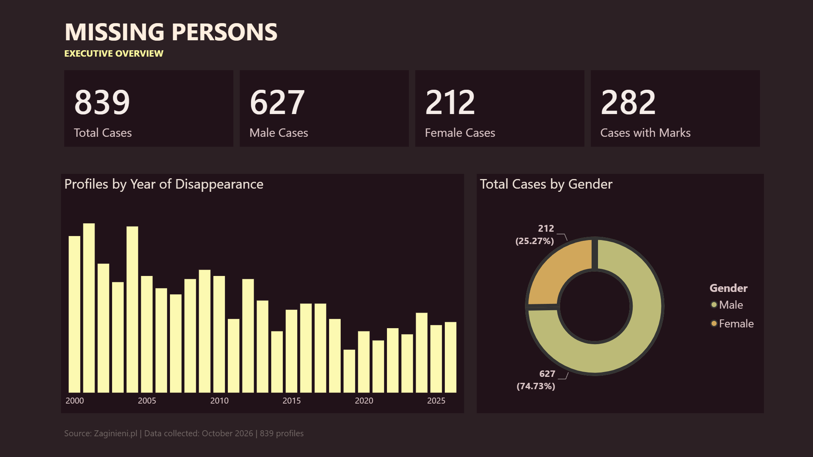
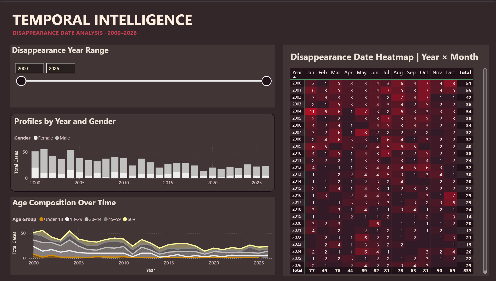
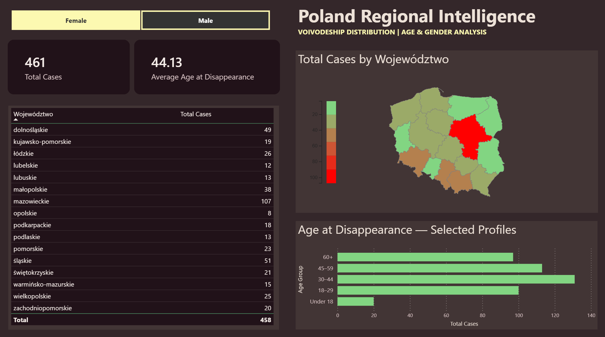
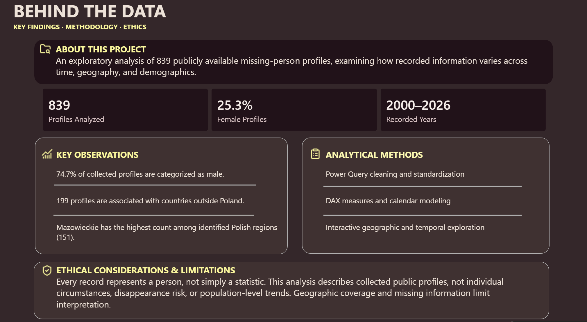

# Missing Persons Intelligence Dashboard

**An Exploratory Power BI Data Analytics Project**

**Tools:** Power BI Desktop · Power Query · DAX · Excel · Data Visualization

## Project Overview

This project presents an exploratory analysis of **839 publicly available missing-person profiles** collected from Zaginieni.pl in October 2026.

The objective was to design an interactive Power BI dashboard examining how recorded profile information varies across time, geography, age groups, and gender.

The project demonstrates the complete analytical workflow, from data preparation and modeling to interactive visualization and responsible interpretation of sensitive information.

## Dashboard Preview

### 1. Executive Overview

An overview of the dataset, including total profiles, gender distribution, distinguishing marks, and annual disappearance-date counts.

### 2. Temporal Intelligence

An exploration of recorded disappearance dates using annual comparisons, age-group trends, and a year-by-month heatmap.

Features include a dynamic year-range slicer and conditional formatting.

### 3. International Geography

An interactive geographic analysis of **199 profiles associated with countries outside Poland**, including a filled country map and a ranked comparison.

### 4. Poland Regional Intelligence

An analysis of missing-person profiles across Poland's 16 voivodeships.

The dashboard includes regional mapping, demographic filters, average age at disappearance, and age-group comparisons.

Of the 637 profiles associated with Poland, 634 could be assigned to a voivodeship.

### 5. Behind the Data

A summary of key observations, analytical methods, limitations, and ethical considerations.

## Data Preparation and Methodology

The analytical workflow involved:

- **Power Query:** Cleaning, transforming, and standardizing source data, including missing values and geographic information.
- **DAX:** Creating measures for profile counts, demographic summaries, and interactive indicators.
- **Data Modeling:** Developing a calendar table and relationships for time-based analysis.
- **Geographic Analysis:** Standardizing country names and extracting Polish voivodeships from location descriptions.
- **Visualization:** Developing KPI cards, stacked charts, a temporal heatmap, interactive maps, and slicers.
- **Dashboard Design:** Creating a consistent custom visual theme with coordinated colors, typography, and layout.

## Key Observations

- The dataset contains **839 collected profiles**.
- Approximately **74.7%** are categorized as male and **25.3%** as female.
- **199 profiles** are associated with countries outside Poland.
- **Mazowieckie** has the highest count among identified Polish voivodeships, with **151 profiles**.

These observations describe the composition of the collected records rather than population-level disappearance patterns.

## Limitations and Ethical Considerations

Missing-person data requires particular care in interpretation and presentation.

This dataset represents a collection of publicly accessible profiles, not a complete population-level register of missing-person incidents.

Differences in reporting, geographic coverage, missing information, and publication practices may influence the observed patterns.

The analysis is descriptive and does not establish disappearance risk, causal relationships, or individual circumstances.

For privacy reasons, this public repository contains only aggregated dashboard screenshots and project documentation. The underlying case-level dataset and Power BI model are not distributed.

## Data Source

**Zaginieni.pl** — publicly accessible missing-person profiles.

**Collection period:** October 2026.

## Project Availability

This repository provides a static demonstration of the Power BI dashboard. The interactive report was developed in Power BI Desktop but is not publicly hosted.

Power BI · Power Query · DAX · Data Cleaning · Data Modeling · Exploratory Data Analysis · Geographic Visualization · Interactive Dashboards · Data Storytelling
